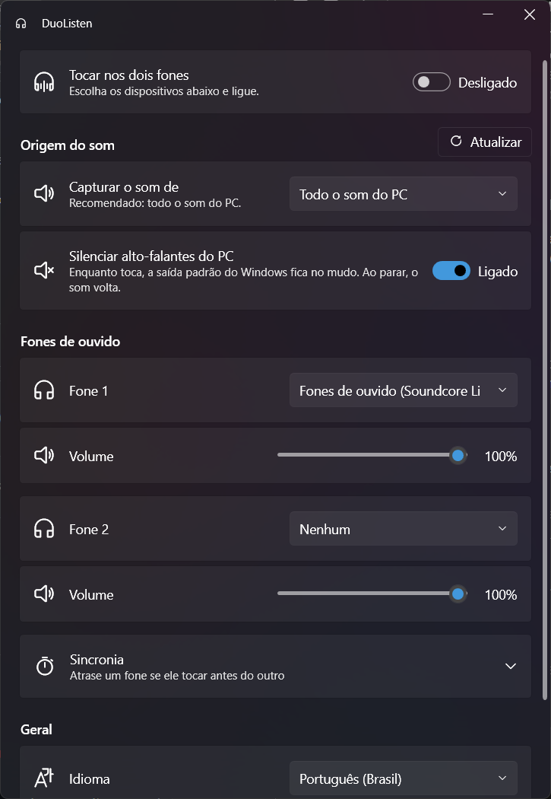

# DuoListen

**English** | [Português (Brasil)](README.pt-BR.md)

Play the same audio on two Bluetooth headphones at once on Windows 11.

> [!NOTE]
> All the code was written by **Claude** (Anthropic's AI). Tested and working on **Windows 11**. No guarantee it works on other systems.

## Why

I wanted to play games with my partner watching, each with our own headphones. The only option that worked was VoiceMeeter Banana, and its interface is cluttered and unpleasant. DuoListen does just this one job, simply.

| VoiceMeeter Banana | DuoListen |
| :---: | :---: |
|  |  |

VoiceMeeter Banana image from the [VB-Audio website](https://vb-audio.com/Voicemeeter/banana.htm).

## How to use

1. Download `DuoListen.exe` from [Releases](../../releases/latest).
2. Open it.
3. Pick your two headphones and turn on the switch at the top.

If Windows SmartScreen shows a warning: **More info → Run anyway**.

## Uninstall

Run `UninstallDuoListen.bat` in the same folder as `DuoListen.exe`.
