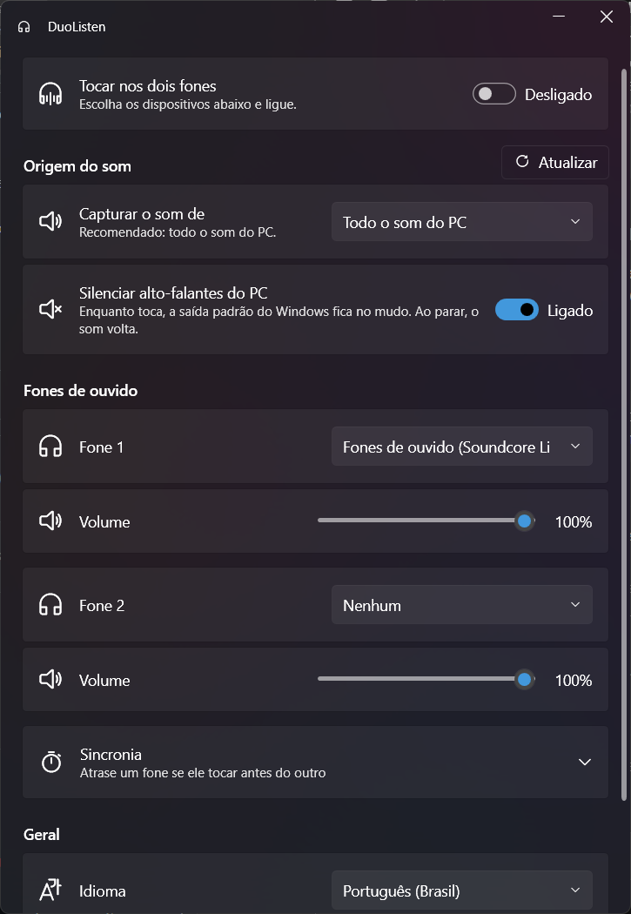

# DuoListen

[English](README.md) | **Português (Brasil)**

Toque o mesmo áudio em dois fones Bluetooth ao mesmo tempo no Windows 11.

- **Fácil de usar:** escolha os dois fones e ligue. Um clique.
- **Nada para instalar:** é um único `.exe`. É só abrir.
- **Sem drivers:** sem cabos de áudio virtuais nem programas extras.
- **Leve:** consumo mínimo de CPU, GPU e memória RAM.
- **Fácil de desinstalar:** um botão dentro do próprio app.

> [!NOTE]
> Todo o código foi feito pela **Claude** (IA da Anthropic). Testado e funcionando no **Windows 11**. Não garanto o funcionamento em outros sistemas.

## Por quê

Eu queria jogar com a minha companheira assistindo, cada um com o seu fone. A única opção que funcionava era o VoiceMeeter Banana, que tem uma interface poluída e desagradável. O DuoListen faz só isso, de forma simples.

| VoiceMeeter Banana | DuoListen |
| :---: | :---: |
|  |  |

Imagem do VoiceMeeter Banana tirada do [site da VB-Audio](https://vb-audio.com/Voicemeeter/banana.htm).

## Como usar

1. Baixe o `DuoListen.exe` em [Releases](../../releases/latest).
2. Abra.
3. Escolha os dois fones e ligue a chave no topo.

Se o Windows SmartScreen avisar: **Mais informações → Executar assim mesmo**.

## Desinstalar

No app, clique em **Desinstalar** (lá embaixo). Ele apaga o app, as configurações e os arquivos temporários.

Ou rode o `UninstallDuoListen.bat` na mesma pasta do `DuoListen.exe`.
